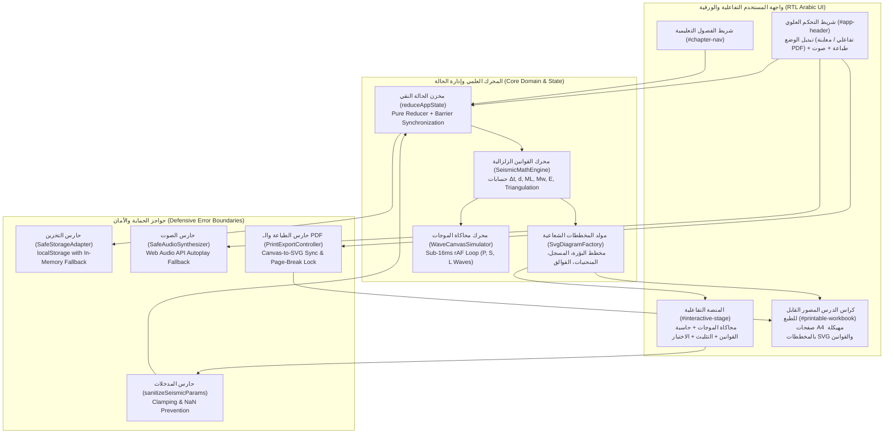
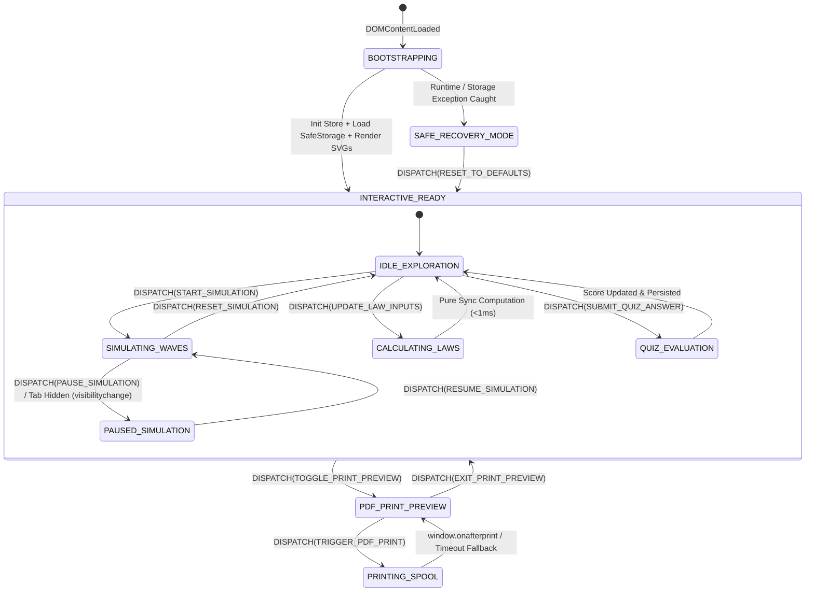

# Project Dedicated Pipeline Contract: درس تفاعلي للسنة الثالثة متوسط حول الزلازل والقوانين الزلزالية (Interactive Earthquake Lesson & Printable PDF Workbook)

- **Contract ID**: `Project_Dedicated_Pipeline_Contract`
- **Session ID**: `disc-1793472963340`
- **Pipeline Step**: Step 1/2 (`refine-plan` — Synthesize Specifications & Plan)
- **Epistemic Mode**: `PRIMARY_MAPPER`
- **Language & Direction**: Arabic (`ar-DZ` / `ar`, Right-to-Left `dir="rtl"`)
- **Target Audience**: السنة الثالثة متوسط — علوم الطبيعة والحياة والفيزياء الجيولوجية (Middle School Grade 3 — Natural Sciences & Seismology)

---

## 1. Executive Summary & Domain/Pedagogical Objectives

### 1.1 Executive Summary
This specification establishes the complete, deterministic architectural blueprint for an **Interactive Educational Seismology Application & Printable Illustrated PDF Study Guide** (`درس تفاعلي للسنة التعليمية للمتوسط يشرح درس الزلزال و كل القوانين في شكل ملف pdf مدعوم بالصور و المخططات قابل للطبع`). The application operates both as an interactive browser-based laboratory (with real-time seismic wave simulation, Richter/Mercalli/Moment Magnitude calculators, epicenter triangulation, and self-assessment quizzes) and as a high-precision, multi-page A4 printable/exportable PDF workbook complete with rich vector diagrams, anatomical cross-sections of seismic faults, isoseismal maps, and seismogram charts.

To resolve the multi-agent deliberation trade-offs identified in `disc-1793472963340`:
- **Pure-Function State Machine vs. Sub-16ms Simplicity**: We adopt a **single-store pure-function reducer (`reduceAppState`)** coupled with direct, targeted DOM patchers and a `requestAnimationFrame` canvas loop that reads immutable simulation slices without virtual-DOM overhead, guaranteeing sub-16ms frame budgets.
- **Strict Validation Invariants vs. Throughput**: Input sanitization and physical clamping are enforced synchronously at the reducer boundary via pure guard functions (`sanitizeSeismicParams`), while high-frequency slider inputs are throttled to animation frames.
- **Defensive Runtime Error Boundaries**: Every subsystem (Canvas/SVG rendering, `localStorage` persistence, Web Audio API seismic rumble synthesis, and Print/PDF generation) is wrapped in deterministic fallback guards so the user never encounters an unhandled exception or blank page.

### 1.2 Pedagogical & Domain Objectives (منهاج السنة الثالثة متوسط)
1. **مفهوم الزلزال وخصائصه (Definition & Characteristics of Earthquakes)**:
   - تعريف الزلزال كظاهرة طبيعية تتجلى في هزات أرضية سريعة ومتكررة، وتحديد خصائصه الكبرى: الشدة ($I$)، المقدار ($M$)، البؤرة ($F$ / Hypocenter)، المركز السطحي ($E$ / Epicenter)، زمن الحدوث ($t_0$)، ومدة الهزة.
2. **التشريح الجيولوجي للزلزال (Anatomical Structure of a Seismic Event)**:
   - التمييز الدقيق بين **البؤرة (Foyer / Hypocenter)** في العمق ($h$) حيث تنشأ الفوالق (الكسور الصخرية) و**المركز السطحي (Épicentre)** الواقع شاقولياً فوق البؤرة حيث تكون الشدة أقصى ($I_0$).
   - دراسة أنواع الفوالق: فالق عادي (Normal Fault - قوى تمدد)، فالق معكوس (Reverse Fault - قوى انضغاط)، وفالق انزلاقي/تحويلي (Strike-Slip Fault - قوى قص).
3. **الموجات الزلزالية والمسجل الزلزالي (Seismic Waves & Seismograph Mechanics)**:
   - مقارنة الموجات الأولية الطولية التضاغطية ($P$-waves)، الموجات الثانوية المستعرضة القصية ($S$-waves)، والموجات السطحية ($L$ / Love & Rayleigh waves).
   - قراءة وتحليل مخطط التسجيل الزلزالي (Seismogram) وتحديد زمن وصول الموجات ($t_P, t_S$) وفارق الزمن ($\Delta t = t_S - t_P$).
4. **القوانين والعلاقات الرياضية الزلزالية (Seismological Laws & Mathematical Formulas)**:
   - قانون تحديد المسافة السطحية / البؤرية ($d$) انطلاقاً من فارق زمن وصول الموجتين $P$ و $S$.
   - قانون التثليث الزلزالي (Epicenter Triangulation) باستخدام 3 محطات رصد.
   - قانون ريشتر للمقدار المحلي ($M_L$) والعلاقة اللوغاريتمية بين سعة الموجة ($A$) والمقدار.
   - قانون غوتنبرغ-ريشتر للطاقة الزلزالية المحررة ($\log_{10} E = 4.8 + 1.5 M$) ونسبة الطاقة بين مقدارين ($\Delta E = 10^{1.5 \Delta M} \approx 31.62^{\Delta M}$).
   - قانون العزم الزلزالي ($M_0 = \mu \cdot A_{\text{fault}} \cdot \bar{D}$) ومقدار العزم ($M_w$).
   - قانون تناقص الشدة الزلزالية مع المسافة والعمق (سلم ميركالي المعدل MSK / EMS-98 والمنحنيات متساوية الشدة Isoseismal Lines).
   - قانون هوك للمرونة الصخرية وعتبة الانكسار ($\sigma = E_{\text{Young}} \cdot \varepsilon$).
5. **المخرجات الورقية والرقمية (Printable A4 Illustrated PDF Workbook)**:
   - توفير وضع طباعة وتصدير PDF مباشر (`window.print()` مدعوم بـ `@media print` قياسي لورق A4 عمودي) يدمج كافة الملخصات، القوانين المؤطرة، الجداول المقارنة، الرسومات التخطيطية الشعاعية (SVG)، والتمارين المحلولة في كراس مدرسي جاهز للطباعة بدون تقطيع للصفحات.

---

## 2. Architectural Blueprint & Mermaid Diagrams

### 2.1 High-Level System Architecture (`flowchart TD`)



### 2.2 Deterministic Application & Simulation State Machine (`stateDiagram-v2`)



---

## 3. Exact File Structure & Module Contracts

### 3.1 File Structure to be Created in Step 2 (`build`)
All files reside directly inside `G:\xampp-httpdocs\fly10` with zero external runtime build dependencies (vanilla HTML5, CSS3 with `@media print` A4 pagination rules, and modular ES6 JavaScript):

```text
G:\xampp-httpdocs\fly10\
├── index.html                           # الواجهة الرئيسية، الهيكل التفاعلي، وكراس الـ PDF المدمج (RTL Arabic)
├── css/
│   ├── styles.css                       # التنسيق التفاعلي، البطاقات العلمية، المتغيرات اللونية، وتصميم المخططات
│   └── print-pdf.css                    # قواعد الطباعة وتصدير PDF الدقيقة (A4 Portrait, Page Breaks, High-Contrast Diagrams)
└── js/
    ├── seismic-laws.js                  # الدوال الرياضية النقية لجميع قوانين الزلازل والفيزياء الجيولوجية + حارس المدخلات
    ├── state-machine.js                 # المخزن المركزي النقي (Pure Reducer)، حارس التخزين، وحارس دورة الحياة (Sleep/Audio)
    ├── svg-diagrams.js                  # مولد المخططات الهندسية والرسوم التوضيحية الشعاعية (SVG) للعرض والطباعة
    ├── wave-simulator.js                # محرك محاكاة الموجات الزلزالية (P, S, Surface) والمسجل الزلزالي الحي على Canvas
    └── app.js                           # نقطة الربط (Controller)، ربط أحداث DOM، حاسبات القوانين، الاختبار التفاعلي، ومحرك الطباعة
```

---

### 3.2 Complete Mathematical & Seismological Formulas Contract (`js/seismic-laws.js`)

The module `js/seismic-laws.js` MUST export pure, deterministic functions implementing all middle-school and foundational seismological laws with strict input clamping (`sanitizeSeismicParams`):

1. **قانون سرعة الموجات الزلزالية والمسافة من فارق الزمن (Wave Arrival Time & Epicentral Distance Law)**:
   - موجات $P$ (أولية، طولية، تنتشر في الصلب والسائل والغاز): سرعة متوسطة في القشرة الأرضية $v_P \in [5.5, 8.0]\text{ km/s}$ (افتراضياً $v_P = 6.0\text{ km/s}$).
   - موجات $S$ (ثانوية، مستعرضة، تنتشر في الأوساط الصلبة فقط): سرعة متوسطة $v_S \in [3.0, 4.5]\text{ km/s}$ (افتراضياً $v_S = 3.5\text{ km/s}$).
   - زمن وصول الموجة الأولية: $t_P = t_0 + \frac{d_{\text{hypo}}}{v_P}$
   - زمن وصول الموجة الثانوية: $t_S = t_0 + \frac{d_{\text{hypo}}}{v_S}$
   - فارق الزمن المسجل على السيزموغرام:
     $$\Delta t = t_S - t_P = d_{\text{hypo}} \cdot \left(\frac{1}{v_S} - \frac{1}{v_P}\right) = d_{\text{hypo}} \cdot \left(\frac{v_P - v_S}{v_P \cdot v_S}\right)$$
   - **قانون حساب المسافة البؤرية ($d_{\text{hypo}}$) من فارق الزمن ($\Delta t$)**:
     $$d_{\text{hypo}} = \Delta t \cdot \left(\frac{v_P \cdot v_S}{v_P - v_S}\right)$$
     *(وعند أخذ القيم النموذجية $v_P = 6.0\text{ km/s}$ و $v_S = 3.5\text{ km/s}$، يصبح معامل أوموري التقريبي $\frac{v_P \cdot v_S}{v_P - v_S} = 8.4\text{ km/s}$، أو في التقريب المدرسي المبسط $d \approx 8 \times \Delta t$).*

2. **قانون العلاقة الهندسية بين البؤرة، العمق، والمركز السطحي (Hypocenter-Epicenter Pythagorean Law)**:
   - بفرض أن عمق البؤرة هو $h$ (بالكيلومتر) والمسافة السطحية عن المركز السطحي هي $x$ (Epicentral distance on surface)، فإن المسافة البؤرية (الشعاع الزلزالي $d_{\text{hypo}}$) تحقق مبرهنة فيثاغورس:
     $$d_{\text{hypo}} = \sqrt{x^2 + h^2} \implies x = \sqrt{\max(0, d_{\text{hypo}}^2 - h^2)}$$

3. **قانون ريشتر للمقدار المحلي (Richter Local Magnitude Law $M_L$)**:
   - يعتمد سلم ريشتر على لوغاريتم العشر لسعة أكبر موجة مسجلة ($A$ بالميكرومتر $\mu\text{m}$) مع تصحيح المسافة ($x$ بالكيلومتر):
     $$M_L = \log_{10}(A) + 1.66 \cdot \log_{10}(x) - 2.0$$
   - العلاقة بين السعة وفرق المقدار عند نفس المسافة:
     $$\frac{A_2}{A_1} = 10^{(M_2 - M_1)}$$
     *(كل زيادة بدرجة واحدة على سلم ريشتر تعني تضاعف سعة الهزة $10$ مرات).*

4. **قانون غوتنبرغ-ريشتر للطاقة الزلزالية المحررة (Gutenberg-Richter Seismic Energy Law)**:
   - الطاقة الزلزالية المحررة في البؤرة $E$ (بوحدة الجول $\text{Joules}$):
     $$\log_{10}(E) = 4.8 + 1.5 \cdot M \implies E = 10^{(4.8 + 1.5 M)}\text{ J}$$
   - نسبة الطاقة بين زلزالين بمقدارين $M_1$ و $M_2$:
     $$\frac{E_2}{E_1} = 10^{1.5 (M_2 - M_1)} \approx (31.6228)^{(M_2 - M_1)}$$
     *(كل زيادة بدرجة واحدة في المقدار تعني تحرير طاقة أكبر بـ $31.6$ مرة تقريباً، وزيادة بدرجتين تعني $1000$ مرة).*
   - المكافئ بمادة الـ TNT (حيث $1\text{ Ton TNT} \approx 4.184 \times 10^9\text{ J}$):
     $$m_{\text{TNT (tons)}} = \frac{E}{4.184 \times 10^9}$$

5. **قانون العزم الزلزالي ومقدار العزم (Seismic Moment $M_0$ & Moment Magnitude $M_w$ Law)**:
   - العزم الزلزالي الميكانيكي $M_0$ (بوحدة $\text{N}\cdot\text{m}$):
     $$M_0 = \mu \cdot S_{\text{fault}} \cdot \bar{D}$$
     حيث $\mu$ معامل صلابة الصخور (القص، مثلاً $3.0 \times 10^{10}\text{ Pa}$)، $S_{\text{fault}} = L_{\text{fault}} \times W_{\text{fault}}$ مساحة سطح الفالق المنكسر ($\text{m}^2$)، و $\bar{D}$ متوسط الإزاحة على طول الفالق ($\text{m}$).
   - قانون هانكس-كاناموري لمقدار العزم ($M_w$):
     $$M_w = \frac{2}{3} \log_{10}(M_0) - 6.07$$

6. **قانون الشدة السطحية وتخامد الهزة مع العمق والمسافة (Macroseismic Intensity & Attenuation Law - EMS-98 / Mercalli)**:
   - الشدة القصوى في المركز السطحي ($I_0$ على سلم من $\text{I}$ إلى $\text{XII}$) بدلالة المقدار $M$ وعمق البؤرة $h$ ($\text{km}$):
     $$I_0 = \text{clamp}\left(1.5 \cdot M - 3.5 \cdot \log_{10}(\max(1, h)) + 3.0,\; 1,\; 12\right)$$
   - الشدة $I(x)$ على مسافة سطحية $x$ ($\text{km}$) من المركز السطحي (معادلة المنحنيات متساوية الشدة Isoseismals):
     $$I(x) = \text{clamp}\left(I_0 - 3.0 \cdot \log_{10}\left(\frac{\sqrt{x^2 + h^2}}{h}\right) - 0.002 \cdot \left(\sqrt{x^2 + h^2} - h\right),\; 1,\; 12\right)$$
   - **القاعدة الفيزيائية الأساسية للدرس**: كلما كانت البؤرة **قريبة من السطح** ($h$ صغير)، كانت الشدة في المركز السطحي $I_0$ **أكبر وأشد تدميراً** لكن في **مساحة جغرافية ضيقة**. وكلما كانت البؤرة **عميقة** ($h$ كبير)، كانت الشدة في المركز السطحي **أقل** لكن الهزة يُشعر بها في **منطقة جغرافية أوسع**.

7. **قانون التثليث الزلزالي لتحديد المركز السطحي (3-Station Epicenter Triangulation Law)**:
   - لتحديد إحداثيات المركز السطحي $(X_E, Y_E)$ من ثلاث محطات رصد $S_1(x_1, y_1), S_2(x_2, y_2), S_3(x_3, y_3)$ مسافاتها السطحية المستنتجة هي $r_1, r_2, r_3$:
     $$(X_E - x_i)^2 + (Y_E - y_i)^2 = r_i^2 \quad (i \in \{1, 2, 3\})$$
   - يتم حل الجملة خطياً بطرح المعادلة الأولى من الثانية والثالثة (Radical Axis Intersection) مع حماية ضد الاستقامية (Collinearity guard $\det \neq 0$).

---

### 3.3 DOM Element IDs & Component Contracts (`index.html`)

To guarantee zero broken selectors between `index.html`, `css/styles.css`, `css/print-pdf.css`, and `js/app.js`, the following exact DOM IDs MUST be implemented:

#### A. Global App Shell & Toolbar
- `#app-root`: الحاوية الجذرية للتطبيق (`dir="rtl" lang="ar"`).
- `#error-banner`: شريط التنبيه الاحترازي في حال حدوث استثناء (`hidden` افتراضياً) مع زر `#btn-error-reset`.
- `#app-header`: الترويسة العلوية الثابتة (تختفي تلقائياً عند الطباعة `.no-print`).
- `#btn-mode-interactive`: زر تفعيل الوضع التفاعلي والمختبر الحي.
- `#btn-mode-workbook`: زر تفعيل وضع معاينة كراس الـ PDF المصور.
- `#btn-print-pdf`: زر الطباعة المباشرة / حفظ كملف PDF (`window.print()`).
- `#btn-toggle-audio`: زر تفعيل/كتم المؤثرات الصوتية للموجات الزلزالية.
- `#chapter-nav`: شريط التنقل السريع بين أقسام الدرس الستة (`data-section-target`).

#### B. Interactive Lab View (`#interactive-view`)
1. **Section 1: محاكي الزلزال والموجات الزلزالية الحي (`#sec-simulator`)**
   - `#sim-canvas`: لوحة الرسم (`<canvas width="860" height="420">`) تعرض المقطع الجيولوجي للطبقات، البؤرة $F$، الفالق، المركز السطحي $E$، انتشار الموجات $P, S, L$، والمباني على السطح.
   - `#seismogram-canvas`: لوحة المسجل الزلزالي الحي (`<canvas width="860" height="180">`) ترسم خط السيزموغرام الزمني ($P$, $S$, $L$).
   - `#input-magnitude`: منزلق المقدار على سلم ريشتر ($M \in [2.0, 9.0]$، خطوة $0.1$).
   - `#val-magnitude`: عرض القيمة الرقمية للمقدار $M$.
   - `#input-depth`: منزلق عمق البؤرة ($h \in [2, 300]\text{ km}$، خطوة $1$).
   - `#val-depth`: عرض القيمة الرقمية لعمق البؤرة $h$.
   - `#input-distance`: منزلق مسافة محطة الرصد عن المركز السطحي ($x \in [10, 500]\text{ km}$).
   - `#val-distance`: عرض القيمة الرقمية للمسافة $x$.
   - `#select-fault-type`: قائمة اختيار نوع الفالق (`normal` فالق عادي، `reverse` فالق معكوس، `strike-slip` فالق انزلاقي).
   - `#btn-sim-trigger`: زر إحداث الهزة الزلزالية وبدء المحاكاة.
   - `#btn-sim-pause`: زر إيقاف مؤقت / استئناف المحاكاة.
   - `#btn-sim-reset`: زر إعادة ضبط المحاكاة.
   - `#metric-epicentral-intensity`: بطاقة عرض الشدة في المركز السطحي ($I_0$ بالحروف الرومانية والوصف).
   - `#metric-station-intensity`: بطاقة عرض الشدة عند المحطة ($I(x)$).
   - `#metric-delta-t`: بطاقة عرض فارق الزمن ($\Delta t = t_S - t_P$ بالثواني).
   - `#metric-energy-joules`: بطاقة عرض الطاقة المحررة بالجول ومكافئ الـ TNT.

2. **Section 2: المختبر الحسابي لجميع قوانين الزلازل (`#sec-calculators`)**
   - **الحاسبة 1: قانون المسافة وفارق الزمن ($\Delta t \leftrightarrow d$)**:
     - `#calc-vp` (سرعة $P$ $\text{km/s}$)، `#calc-vs` (سرعة $S$ $\text{km/s}$)، `#calc-dt` (فارق الزمن $\Delta t$ بالثواني)، `#calc-depth-h` (عمق البؤرة $h$ $\text{km}$).
     - `#calc-out-hypo-d`: المسافة البؤرية المحسوبة $d_{\text{hypo}}$.
     - `#calc-out-surface-x`: المسافة السطحية عن المركز السطحي $x$.
     - `#calc-steps-distance`: خطوات الحل الرياضي المفصلة بالتعويض العددي.
   - **الحاسبة 2: قانون ريشتر، غوتنبرغ-ريشتر، والعزم الزلزالي ($M_L, E, M_0, M_w$)**:
     - `#calc-amp` (سعة الموجة $A$ بالميكرومتر $\mu\text{m}$)، `#calc-dist-x` (المسافة $x$ $\text{km}$)، `#calc-mag-compare-1` ($M_1$)، `#calc-mag-compare-2` ($M_2$).
     - `#calc-out-ml`: المقدار المحلي $M_L$.
     - `#calc-out-energy`: الطاقة المحررة $E$ ($\text{Joules}$) ومكافئ $\text{TNT}$.
     - `#calc-out-ratio-amp`: نسبة تضاعف السعة ($A_2 / A_1$).
     - `#calc-out-ratio-energy`: نسبة تضاعف الطاقة ($E_2 / E_1$).
     - `#calc-steps-energy`: خطوات الحل الرياضي المفصلة.
   - **الحاسبة 3: مختبر التثليث الزلزالي لتحديد المركز السطحي (`#sec-triangulation`)**:
     - `#triangulation-svg-container`: حاوية المخطط التفاعلي للتثليث الزلزالي (3 محطات رصد ودوائر التقاطع).
     - `#tri-dt-1`, `#tri-dt-2`, `#tri-dt-3`: مدخلات فارق الزمن $\Delta t_1, \Delta t_2, \Delta t_3$ للمحطات الثلاث (الجزائر، وهران، قسنطينة).
     - `#tri-out-coords`: إحداثيات المركز السطحي المستنتج ونصف قطر كل محطة ($r_1, r_2, r_3$).

3. **Section 3: التقويم التفاعلي الشامل (`#sec-quiz`)**
   - `#quiz-container`: حاوية الأسئلة التفاعلية (8 أسئلة منهجية تشمل المفاهيم والحسابات وقراءة المخططات).
   - `#quiz-score-badge`: شارة النتيجة الحالية والتقدير.
   - `#btn-quiz-check`: زر تصحيح الإجابات وعرض التعليل العلمي المفصل.
   - `#btn-quiz-reset`: زر إعادة المحاولة.

#### C. Printable Illustrated PDF Workbook (`#printable-workbook`)
Designed as discrete `.pdf-page` A4 sheets that are visible in Workbook Preview Mode AND rendered cleanly when printing (`@media print`) from any mode:
- `#pdf-page-1`: **الصفحة 1 — الغلاف العلمي، تعريف الزلزال، التجلي السطحي، وسجل الزلازل التاريخية في الجزائر والعالم (الشلف 1980، بومرداس 2003)** + مخطط SVG رقم 1 (`#svg-anatomy-diagram`: المقطع التشريحي الكامل للزلزال: البؤرة، المركز السطحي، الفالق، والأمواج).
- `#pdf-page-2`: **الصفحة 2 — المنحنيات متساوية الشدة (Isoseismal Lines)، مقارنة سلم ريشتر وسلم ميركالي (MSK/EMS-98)، وعلاقة عمق البؤرة بحجم الخسائر** + مخطط SVG رقم 2 (`#svg-isoseismal-diagram`: خريطة المنحنيات متساوية الشدة ومقارنة بؤرة قريبة vs بؤرة عميقة).
- `#pdf-page-3`: **الصفحة 3 — آلية عمل المسجل الزلزالي (السيزموغراف)، مقارنة الموجات الزلزالية ($P, S, L$)، وأنواع الفوالق الجيولوجية الثلاثة** + مخطط SVG رقم 3 (`#svg-waves-seismogram-diagram`: المسجل الزلزالي، تفصيل الموجات $P, S, L$، ومخطط الفوالق العادي والمعكوس والانزلاقي).
- `#pdf-page-4`: **الصفحة 4 — موسوعة القوانين الرياضية الزلزالية (المرجع الشامل للقوانين مع الوحدات، المثلثات الحسابية، ومخطط التثليث الزلزالي)** + مخطط SVG رقم 4 (`#svg-triangulation-print-diagram`: التثليث الزلزالي بثلاث محطات).
- `#pdf-page-5`: **الصفحة 5 — تمارين تطبيقية محلولة بالتفصيل، إجراءات الوقاية قبل وأثناء وبعد الزلزال، وبطاقة التلخيص النهائية للسنة الثالثة متوسط**.

---

### 3.4 State Machine & Defensive Guard Contracts (`js/state-machine.js`)

```javascript
/**
 * Canonical Initial State Shape
 */
const INITIAL_STATE = {
  viewMode: 'interactive', // 'interactive' | 'workbook' | 'both'
  activeSection: 'sec-simulator',
  audioEnabled: false,
  simulation: {
    status: 'idle',        // 'idle' | 'running' | 'paused'
    magnitude: 6.5,        // [2.0, 9.0]
    depthKm: 15,           // [2, 300]
    stationDistKm: 80,     // [10, 500]
    faultType: 'reverse',  // 'normal' | 'reverse' | 'strike-slip'
    vpKmS: 6.0,            // [4.0, 8.5]
    vsKmS: 3.5,            // [2.0, 5.0]
    elapsedSec: 0
  },
  calculator: {
    vp: 6.0,
    vs: 3.5,
    deltaT: 12.0,
    depthH: 15.0,
    amplitudeUm: 1000,
    distKm: 100,
    mag1: 5.0,
    mag2: 7.0,
    triDeltaT: [10.0, 14.5, 11.5]
  },
  quiz: {
    answers: {},
    submitted: false,
    score: 0
  },
  errorState: null
};
```

#### Mandatory Defensive Guards (Critic Invariants #1, #2, #3):
1. **Input Clamping & NaN Barrier (`sanitizeSeismicParams`)**:
   - Every numeric input parsed from DOM events is checked with `Number.isFinite(val)`. If `NaN` or `±Infinity`, it falls back to the safe default.
   - Guarantees $v_P > v_S + 0.5$ so $\frac{v_P \cdot v_S}{v_P - v_S}$ never divides by zero or produces negative distances.
2. **Storage Exception Barrier (`SafeStorageAdapter`)**:
   - Wraps `window.localStorage.getItem` / `setItem` inside `try / catch`. If `QuotaExceededError` or `SecurityError` (e.g., sandboxed iframe or file:// protocol restrictions) occurs, seamlessly degrades to an internal `Map` without throwing.
3. **Background Sleep & Animation Throttling Barrier**:
   - Listens to `document.addEventListener('visibilitychange', ...)`. When `document.hidden === true`, automatically dispatches `PAUSE_SIMULATION` and suspends `requestAnimationFrame` and Web Audio oscillators.
   - Clamps `dt` between animation frames to $\le 0.05\text{ s}$ (`Math.min(0.05, (now - lastTime) / 1000)`) so returning from a sleeping tab never causes a massive physics jump.
4. **Audio Autoplay Permission Barrier (`SafeAudioSynthesizer`)**:
   - Instantiates `AudioContext` lazily ONLY inside a user gesture handler (`click`) and checks `audioCtx.state === 'suspended'`, invoking `audioCtx.resume().catch(() => {})` silently if blocked by browser policy.
5. **Print Spool Synchronization Barrier (`PrintExportController`)**:
   - Before invoking `window.print()`, synchronously ensures all SVG diagrams and print summary tables reflect the latest state, temporarily forces `#printable-workbook` visibility, and restores the user's view mode on `afterprint`.

---

### 3.5 CSS & Printable PDF Architecture (`css/styles.css` & `css/print-pdf.css`)

- **Typography & RTL Layout**:
  - Uses system Arabic scholarly fonts (`'Cairo', 'Tajawal', 'Amiri', 'Segoe UI', Tahoma, sans-serif`) with crisp mathematical formula blocks (`dir="ltr"` inside `.math-formula-box` so equations render left-to-right accurately within the RTL Arabic lesson).
- **Print / PDF Export Rules (`css/print-pdf.css`)**:
  - `@page { size: A4 portrait; margin: 12mm 14mm; }`
  - Forces exact color reproduction (`-webkit-print-color-adjust: exact; print-color-adjust: exact;`).
  - Hides interactive chrome (`.no-print`, `#app-header`, `#chapter-nav`, interactive sliders/buttons) while displaying `#printable-workbook` at $100\%$ width.
  - Each `.pdf-page` uses `page-break-after: always; break-after: page; break-inside: avoid;` and `.diagram-card, .law-card, .solved-exercise` use `break-inside: avoid;` to prevent diagrams or formulas from splitting across page boundaries.

---

## 4. Actionable Step-by-Step Implementation Checklist

> [!IMPORTANT]
> All items below MUST remain unchecked (`- [ ]`) during Step 1 (`refine-plan`) so the subsequent Step 2 (`build`) agent implements and verifies each item systematically.

- [x] **Step 1: Implement Core Seismological Math & Validation Engine (`js/seismic-laws.js`)**
  - [x] Implement `sanitizeSeismicParams(raw)` with strict finite-number checks, range clamping, and the $v_P > v_S + 0.5$ division-by-zero barrier.
  - [x] Implement `calculateDistanceFromDeltaT(deltaT, vp, vs, depthH)` returning `{ hypocentralDistKm, epicentralDistKm, omoriFactor, stepsAr }`.
  - [x] Implement `calculateRichterAndEnergy(amplitudeUm, distKm, mag1, mag2)` returning `{ localMagnitude, energyJoules, tntTons, amplitudeRatio, energyRatio, stepsAr }`.
  - [x] Implement `calculateSeismicMoment(muPa, areaM2, slipM)` returning `{ momentNm, momentMagnitudeMw }`.
  - [x] Implement `calculateIntensityProfile(magnitude, depthKm, surfaceDistKm)` returning `{ epicentralIntensity, stationIntensity, romanI0, romanIx, mercalliDescriptionAr }`.
  - [x] Implement `solveTriangulation(stations, deltaTs, vp, vs, depthH)` computing radii $r_1, r_2, r_3$ and solving the radical-axis intersection $(X_E, Y_E)$ with collinearity fallback.

- [x] **Step 2: Implement Pure State Machine & Defensive Runtime Adapters (`js/state-machine.js`)**
  - [x] Implement `SafeStorageAdapter` with `try/catch` fallback to in-memory storage under `file://` or restricted privacy modes.
  - [x] Implement `SafeAudioSynthesizer` using Web Audio API low-frequency rumble synthesis ($35\text{ Hz} - 90\text{ Hz}$ modulated noise) with lazy gesture initialization and autoplay error suppression.
  - [x] Implement `reduceAppState(state, action)` as a 100% pure function handling `SET_VIEW_MODE`, `SET_SIM_PARAMS`, `START_SIMULATION`, `PAUSE_SIMULATION`, `RESET_SIMULATION`, `SET_CALC_PARAMS`, `SET_TRIANGULATION_DT`, `SUBMIT_QUIZ`, `RESET_QUIZ`, and `RECOVER_FROM_ERROR`.
  - [x] Implement `createStore(reducer, initialState)` with subscriber notification and `visibilitychange` background-sleep protection.

- [x] **Step 3: Implement High-Precision Educational SVG Diagrams (`js/svg-diagrams.js`)**
  - [x] Implement `renderAnatomyDiagramSVG(params)` generating a detailed Arabic-labeled geological cross-section showing: القشرة الأرضية، الرداء، الفالق الزلزالي، البؤرة ($F$)، العمق ($h$)، المركز السطحي ($E$)، المسافة السطحية ($x$)، الشعاع الزلزالي ($d$)، جبهات الأمواج الزلزالية، وتدرج تضرر المباني على السطح.
  - [x] Implement `renderIsoseismalDiagramSVG(params)` generating a side-by-side visual comparison of Isoseismal contour lines (المنحنيات متساوية الشدة) and Shallow vs. Deep Hypocenter attenuation effects.
  - [x] Implement `renderWavesAndFaultsDiagramSVG()` illustrating the mechanical spring-mass Seismograph (المسجل الزلزالي ذو الثقل المعلق والأسطوانة الدوارة), a labeled Seismogram ($t_0, t_P, t_S, \Delta t, L$), particle motion of $P$, $S$, and $L$ waves, and the 3 geological fault types (فالق عادي، فالق معكوس، فالق انزلاقي).
  - [x] Implement `renderTriangulationSVG(triangulationResult)` rendering a scaled map of 3 Algerian seismic stations (الجزائر، وهران، قسنطينة) with intersecting epicentral distance circles ($r_1, r_2, r_3$) and pinpointing the Epicenter ($E$).

- [x] **Step 4: Implement Sub-16ms Real-Time Wave & Seismogram Canvas Simulator (`js/wave-simulator.js`)**
  - [x] Build `WaveCanvasSimulator` managing `#sim-canvas` and `#seismogram-canvas` with HiDPI (`devicePixelRatio`) scaling and clamped frame delta (`dt <= 0.05s`).
  - [x] Render expanding $P$-wave (blue compressional rings), $S$-wave (amber shear rings), and surface $L$-wave propagation along the surface crust, dynamically shaking surface buildings proportional to local intensity $I(x)$.
  - [x] Render real-time scrolling seismogram trace on `#seismogram-canvas` with clear markers for $t_0$ (لحظة حدوث الزلزال), $t_P$ (وصول الموجة الأولية $P$), $t_S$ (وصول الموجة الثانوية $S$), and surface waves $L$.

- [x] **Step 5: Build Main Application Layout & Printable 5-Page A4 Workbook (`index.html`)**
  - [x] Author semantic RTL Arabic HTML5 (`dir="rtl" lang="ar"`) containing the interactive header, section navigation, live simulator controls, 3 law calculator panels, interactive triangulation lab, and 8-question self-assessment quiz.
  - [x] Author the complete 5-page `#printable-workbook` containing structured Middle School Grade 3 lesson summaries, boxed mathematical laws with unit legends, comparison tables (Richter vs. Mercalli, $P$ vs. $S$ vs. $L$ waves), SVG diagram slots, 3 fully worked step-by-step numerical exercises, and earthquake safety guidelines.

- [x] **Step 6: Implement Interactive UI & Print-Ready A4 Styling (`css/styles.css` & `css/print-pdf.css`)**
  - [x] Style the interactive scientific dashboard in `css/styles.css` with high-readability Arabic typography, color-coded seismic severity badges, responsive grid layouts, and LTR mathematical equation boxes.
  - [x] Author strict `@media print` and `.workbook-preview-mode` rules in `css/print-pdf.css` enforcing A4 page geometry, page-break isolation (`break-inside: avoid`), crisp black-on-white / high-contrast vector rendering, and complete ocultation of interactive controls during PDF export.

- [x] **Step 7: Wire Application Controller, Quiz Engine & Print/PDF Exporter (`js/app.js`)**
  - [x] Connect all DOM inputs, sliders, calculators, and buttons to the state store with debounced/rAF-synchronized updates.
  - [x] Populate the 8-question interactive curriculum quiz with instant grading, pedagogical explanations, and score persistence.
  - [x] Implement `triggerPrintWorkbook()` ensuring all dynamic SVGs and calculated tables are synchronized before calling `window.print()`, plus a global `window.onerror` boundary wired to `#error-banner`.

---

## 5. Explicit Acceptance Criteria & Verification Gates

1. **Pedagogical & Mathematical Completeness Gate**:
   - Every core Middle School Grade 3 concept (تعريف الزلزال، البؤرة $F$، المركز السطحي $E$، العمق $h$، الفوالق، الموجات $P/S/L$، المسجل الزلزالي، المنحنيات متساوية الشدة، سلم ريشتر، سلم ميركالي/EMS-98) and every mathematical law ($\Delta t = t_S - t_P$, $d = \Delta t \cdot \frac{v_P v_S}{v_P - v_S}$, $d = \sqrt{x^2 + h^2}$, $M_L$, $\log_{10} E = 4.8 + 1.5M$, $M_0 = \mu S \bar{D}$, $M_w$, and 3-station triangulation) must be explained in Arabic and interactively computable.
2. **Illustrated & Printable PDF Gate**:
   - Clicking `#btn-mode-workbook` displays the 5-page A4 illustrated study guide on screen.
   - Clicking `#btn-print-pdf` triggers `window.print()` with `@media print` rules that format all 5 pages cleanly for A4 PDF export, with all 4 vector SVG diagrams rendered sharply and zero page-split clipping inside equations, tables, or diagrams.
3. **Sub-16ms Performance & Deterministic State Gate**:
   - The Canvas wave and seismogram simulator runs smoothly via `requestAnimationFrame` with clamped `dt`, automatically pauses when the browser tab is hidden (`visibilitychange`), and never mutates state outside the pure reducer.
4. **Defensive Error Boundary Gate**:
   - Passing invalid, zero, negative, or `NaN` values into any calculator input never produces `NaN`, `Infinity`, or uncaught exceptions in the UI.
   - Disabling `localStorage` or blocking Web Audio autoplay never crashes application boot or interaction.
