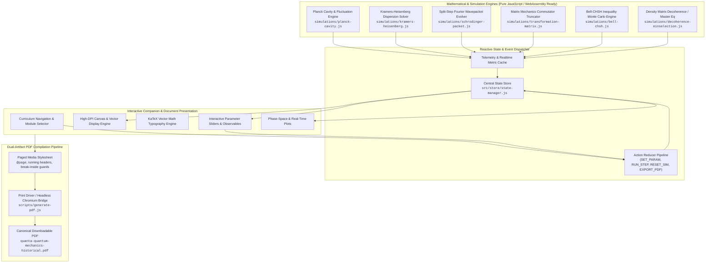
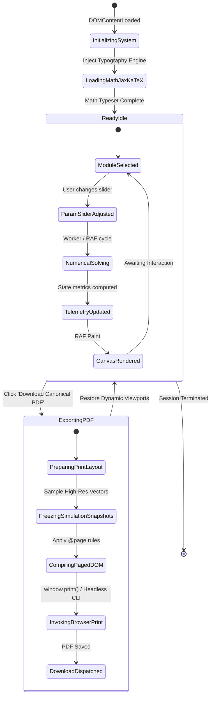

# Implementation Plan & Technical Architecture Contract: Quanta Quantum Mechanics Historical Courseware & Downloadable PDF

---

## 1. Executive Summary & Pedagogical Objectives

### 1.1 Project Vision & Mandate
**Quanta** is an advanced, historically authentic, and mathematically rigorous graduate-level courseware system and publication-grade downloadable document covering the foundational evolution of Quantum Mechanics (1895–1980s). Designed specifically for physicists, researchers, and advanced students (M.Sc./Ph.D. level), the curriculum rejects popularized anecdotal summaries in favor of an **epistemological autopsy of mathematical and physical ruptures**.

The project resolves the fundamental tension between **"Downloadable Print-Grade PDF"** and **"Dynamic Interactive Simulations"** via a synchronized **Hybrid Dual-Artifact Architecture**:
1. **The Canonical Master PDF (`quanta-quantum-mechanics-historical.pdf`)**: A publication-grade, mathematically complete document typeset with precise paged media geometry, vector figures, Computer Modern typography, rigorous derivations, and deep-link/QR access points to interactive state vectors.
2. **The Standalone Interactive Computational Companion (`index.html`)**: A zero-dependency, client-side, high-performance web runtime featuring real-time numerical solvers (split-step Fourier, matrix diagonalization, Kramers-Heisenberg dispersion, and Bell-CHSH testbeds) and an integrated PDF generation pipeline using headless Chromium/Edge paged-media print engine.

```
       ┌────────────────────────────────────────────────────────┐
       │              Quanta Historical Curriculum              │
       │    Graduate-Level Epistemic Ruptures (1895–1980s)      │
       └──────────────────────────┬─────────────────────────────┘
                                  │
                  ┌───────────────┴───────────────┐
                  ▼                               ▼
    ┌───────────────────────────┐   ┌───────────────────────────┐
    │ Canonical Master PDF      │   │ Dynamic Companion Runtime │
    │ • Paged CSS / Print Media │   │ • 6 Live Numerical Engines│
    │ • KaTeX Vector Math       │   │ • Split-Step Wave Sim     │
    │ • Formal Proof Trajectory │   │ • Matrix Diagonalization  │
    │ • PDF Download Generator  │   │ • Parameter Space Scanners│
    └───────────────────────────┘   └───────────────────────────┘
```

### 1.2 Target Audience & Pedagogical Rigor
- **Target Demographic**: Theoretical physicists, applied mathematicians, graduate students in physics and quantum information, and historians of physical science.
- **Assumed Prerequisites**:
  - Hamiltonian and Lagrangian analytical mechanics (Hamilton-Jacobi theory, canonical transformations, Poisson brackets, symplectic geometry).
  - Functional analysis and linear operator theory (Hilbert spaces, unbounded self-adjoint operators, spectral decomposition, distribution theory).
  - Classical electrodynamics (Maxwell-Lorentz theory, cavity resonator modes, Poynting vectors).
  - Classical thermodynamics and statistical mechanics (Boltzmann entropy, phase space ensembles, fluctuation theorems).

### 1.3 The 6 Epistemic Modules
The curriculum traces six foundational historical ruptures:
1. **Module 1: Thermodynamic Inconsistencies & The Quantum of Action (1895–1905)**  
   *Planck's entropy derivatives ($d^2S/dU^2$), Wien displacement, cavity resonator statistics, and Einstein's energy fluctuation inversion $\langle(\Delta E)^2\rangle$.*
2. **Module 2: Dispersion Theory & The Birth of Matrix Mechanics (1913–1925)**  
   *Adiabatic invariants failure, Kramers-Heisenberg dispersion relations, Thomas-Reiche-Kuhn sum rules, Heisenberg Umdeutung, and the non-commutative coordinate algebra $[X, P] = i\hbar I$.*
3. **Module 3: Hamilton-Jacobi Geometry & Wave Mechanics (1923–1926)**  
   *Optical-mechanical analogy, phase waves of de Broglie, wavepacket envelope dispersion, and Schrödinger's derivation via action variable $S = \hbar \arg \psi$.*
4. **Module 4: Transformation Theory & Mathematical Axiomatics (1926–1932)**  
   *Dirac transformation bracket calculus, Jordan canonical representations, von Neumann's rigorous Hilbert space formalization, unbounded operators, and Stone-von Neumann theorem.*
5. **Module 5: Measurement, Non-Locality & Realism Theorems (1935–1967)**  
   *Einstein-Podolsky-Rosen (EPR) reality criterion, Bohmian spin-1/2 reformulation, Bell's inequality, Clauser-Horne-Shimony-Holt (CHSH) correlation violation, and Kochen-Specker contextuality.*
6. **Module 6: Path Integrals & Open Quantum Systems (1948–1980s)**  
   *Feynman's functional integral over histories, stationary phase classical limit ($\delta S = 0$), environment-induced superselection (einselection), and Zurek-Zeh master equation decoherence.*

---

## 2. Architectural Blueprint & Mermaid Diagrams

### 2.1 System Architecture Flowchart
The following architecture details how the mathematical core, interactive simulations, presentation UI, and PDF rendering engine interconnect.



### 2.2 Interactive Simulation & Document Lifecycle State Machine



---

## 3. Exact File Structure & Module Contracts

### 3.1 Workspace Directory Structure
All implementation files will be organized within `F:\fly-app` as follows:

```
F:\fly-app\
├── Quanta_Quanta_Dedicated_Pipeline_contract.md   # [THIS PLAN SPECIFICATION]
├── index.html                                    # Single-Page Interactive Companion & Course Viewer
├── package.json                                  # Project manifest (scripts for PDF compile & lint)
├── css/
│   ├── quanta-core.css                           # Core variables, typography, layout, themes
│   ├── quanta-simulations.css                    # Simulation canvases, sliders, instrumentation
│   └── quanta-print.css                          # Paged-media print styles for pristine PDF output
├── js/
│   ├── store/
│   │   ├── state-manager.js                      # Redux-style deterministic state store & action reducers
│   │   └── types.js                              # Module state shapes, constants, physical constants
│   ├── math/
│   │   ├── complex.js                            # Complex number algebra (multiply, exp, conj, norm)
│   │   ├── fft.js                                # Fast Fourier Transform for split-step wave propagation
│   │   └── linear-algebra.js                     # Matrix eigensolvers (Jacobi / Householder QR)
│   ├── simulations/
│   │   ├── planck-cavity.js                      # Mod 1: Spectral radiance & fluctuation simulator
│   │   ├── kramers-heisenberg.js                 # Mod 2: Dispersion & TRK sum rule simulator
│   │   ├── schrodinger-packet.js                 # Mod 3: 1D Time-dependent Schrödinger split-step solver
│   │   ├── transformation-matrix.js              # Mod 4: Heisenberg matrix commutator [X, P] algebra
│   │   ├── bell-chsh.js                          # Mod 5: Bell-CHSH correlation & angle analyzer
│   │   └── decoherence-einselection.js           # Mod 6: Reduced density matrix off-diagonal decay
│   ├── ui/
│   │   ├── canvas-utils.js                       # HiDPI 2D canvas plotting, vector arrows, grids
│   │   └── app-controller.js                     # UI event delegation, tab switching, sync
│   └── pdf/
│       └── pdf-generator.js                      # PDF export coordinator & print media trigger
└── scripts/
    └── generate-pdf.js                           # Node.js + Headless Chromium automated PDF build script
```

---

### 3.2 DOM Element IDs & Component Hierarchy

To ensure unambiguous implementation in the Build step, every interactive DOM container, canvas, input, and readout has an explicit ID specification:

#### Top-Level Shell
- `#quanta-app-container`: Root container for the full application.
- `#quanta-header`: Header containing title, historical epigraph, and global controls.
  - `#btn-download-pdf`: Primary button to trigger the print-to-PDF pipeline.
  - `#btn-theme-toggle`: Dark/Light presentation theme toggle.
  - `#lbl-active-pipeline-status`: Status badge indicating simulation engine stability.
- `#quanta-navigation`: Tab bar for selecting the active historical module.
  - `#tab-nav-mod1` to `#tab-nav-mod6`: Nav buttons for Modules 1 through 6.
- `#quanta-main-viewport`: Main scrollable area containing the course chapters.
- `#quanta-status-bar`: Bottom fixed bar reporting numerical convergence and runtime FPS.

#### Module 1: Thermodynamic Inconsistencies (`#module-planck-radiation`)
- `#canvas-planck-spectral`: Canvas rendering Wien, Rayleigh-Jeans, and Planck curves.
- `#slider-planck-temp`: Temperature slider ($T \in [1000\text{ K}, 10000\text{ K}]$).
- `#slider-planck-freq-zoom`: Frequency spectrum range zoom.
- `#toggle-wien-curve`: Checkbox to toggle Wien distribution overlay.
- `#toggle-rj-curve`: Checkbox to toggle Rayleigh-Jeans classical divergence.
- `#telemetry-planck-peak-freq`: Real-time Wien displacement peak frequency $\nu_{\text{max}}$.
- `#telemetry-planck-fluctuation`: Energy fluctuation calculation $\langle(\Delta E)^2\rangle$.

#### Module 2: Dispersion & Matrix Mechanics (`#module-dispersion-matrix`)
- `#canvas-dispersion-curve`: Canvas rendering refractive index $n(\nu)$ and absorption profiles.
- `#slider-dispersion-damping`: Oscillator damping parameter $\gamma_k$.
- `#slider-dispersion-strength`: Oscillator strength $f_k$.
- `#table-trk-sum-rule`: Dynamic table verifying Thomas-Reiche-Kuhn sum $\sum f_k = 1$.
- `#canvas-heisenberg-matrix`: Visual heat-map of truncated transition matrix $X_{mn}$.
- `#telemetry-commutator-norm`: Numerical calculation of $\|[X, P] - i\hbar I\|$.

#### Module 3: Hamilton-Jacobi & Wave Mechanics (`#module-schrodinger-waves`)
- `#canvas-schrodinger-wavepacket`: Real-time canvas for $|\psi(x, t)|^2, \text{Re}(\psi), \text{Im}(\psi)$.
- `#canvas-schrodinger-phase`: Phase-space representation $(x, p)$ / Wigner quasi-distribution.
- `#slider-potential-barrier-height`: Potential step/barrier height $V_0$.
- `#slider-packet-initial-momentum`: Initial wavepacket momentum $k_0$.
- `#slider-packet-width`: Initial spatial dispersion $\sigma_x$.
- `#btn-wavepacket-play-pause`: Simulation play/pause toggle.
- `#btn-wavepacket-reset`: Reset wavepacket to initial Gaussian state.
- `#telemetry-packet-norm`: Unitarity check $\int |\psi|^2 dx$ (verifying norm preservation to $10^{-8}$).

#### Module 4: Transformation Theory (`#module-transformation-axiomatics`)
- `#canvas-spectral-decomposition`: Visualization of continuous vs discrete spectrum projection.
- `#select-basis-transformation`: Dropdown switching between Coordinate, Momentum, and Energy bases.
- `#matrix-representation-grid`: Dynamic HTML table displaying $\langle n | \hat{H} | m \rangle$.
- `#telemetry-unitarity-residual`: Residual $\|U^\dagger U - I\|$.

#### Module 5: Realism & Bell-CHSH (`#module-bell-chsh-test`)
- `#canvas-chsh-geometry`: Interactive vector diagram of detector polarizers $\vec{a}, \vec{a}', \vec{b}, \vec{b}'$.
- `#slider-angle-a`: Polarizer angle $\alpha$.
- `#slider-angle-b`: Polarizer angle $\beta$.
- `#btn-run-bell-trials`: Trigger Monte Carlo generation of $N=10,000$ entangled photon pairs.
- `#telemetry-chsh-s-param`: Calculated CHSH parameter $S = |E(a,b) - E(a,b') + E(a',b) + E(a',b')|$.
- `#telemetry-chsh-violation-indicator`: Visual indicator for Bell inequality violation ($S > 2$, Tsirelson bound $2\sqrt{2}$).

#### Module 6: Path Integrals & Decoherence (`#module-pathintegral-decoherence`)
- `#canvas-path-integral-histories`: Visualization of interfering classical and non-classical trajectories.
- `#canvas-density-matrix-decay`: 3D/Isometric heatmap of reduced density matrix $\rho(x, x')$.
- `#slider-decoherence-coupling`: Coupling strength to thermal bath $\Lambda$.
- `#slider-hbar-scaling`: Action scale ratio $S / \hbar$ demonstrating transition to classical stationary phase.
- `#telemetry-purity`: Purity index $\gamma = \text{Tr}(\rho^2)$ tracking transition from pure to mixed state.

---

### 3.3 CSS Architecture & Paged Media Contracts

#### Screen View Styling (`quanta-core.css`, `quanta-simulations.css`)
- **Root Design System**:
  - Color palette: Deep academic navy (`--bg-primary: #0a0f1d`), crisp mathematical slate (`--bg-surface: #141d33`), warm parchment light mode (`--bg-light: #fbfbfd`).
  - Typography: Serif body for historical prose (CMU Serif / Georgia / Latin Modern Math), monospace for numerical readouts (JetBrains Mono / Fira Code).
  - Component layouts: CSS Grid two-column split: left column for analytical derivations and historical analysis; right column for interactive computational instrumentation.

#### Print Paged Media Styling (`quanta-print.css`)
The stylesheet must guarantee exact, publication-ready A4 formatting when compiling to PDF:
```css
@page {
  size: A4 portrait;
  margin: 20mm 15mm 20mm 15mm;
  @top-left {
    content: "Quanta: Historical Foundations of Quantum Mechanics";
    font-family: "Latin Modern Roman", serif;
    font-size: 8pt;
    font-style: italic;
    color: #555555;
  }
  @top-right {
    content: "Graduate Curriculum & Mathematical Treatise";
    font-family: "Latin Modern Roman", serif;
    font-size: 8pt;
    color: #555555;
  }
  @bottom-center {
    content: "Page " counter(page) " of " counter(pages);
    font-family: "Latin Modern Roman", serif;
    font-size: 9pt;
  }
}

@media print {
  body {
    background: #ffffff !important;
    color: #111111 !important;
    font-size: 10.5pt;
    line-height: 1.5;
  }
  .quanta-interactive-controls,
  .quanta-slider-row,
  .btn-print-hide {
    display: none !important;
  }
  .quanta-canvas-print-fallback {
    display: block !important;
    max-width: 100%;
    page-break-inside: avoid;
  }
  .chapter-section {
    page-break-before: always;
  }
  .derivation-box, .theorem-block {
    page-break-inside: avoid;
    border: 1px solid #222;
    padding: 10pt;
    margin: 12pt 0;
    background-color: #fafafa !important;
  }
  .katex-display {
    page-break-inside: avoid;
  }
}
```

---

### 3.4 State Machine Reducer & State Schema

The central state manager (`src/store/state-manager.js`) follows an immutable, deterministic unidirectional data flow:

```javascript
// State Shape Contract
const InitialState = {
  activeModule: 'module-planck-radiation',
  theme: 'dark',
  isGeneratingPDF: false,
  simulationState: {
    planck: {
      temperature: 5500, // Kelvin
      freqMax: 2.5e15,   // Hz
      showWien: true,
      showRayleighJeans: true
    },
    dispersion: {
      damping: 0.05,
      oscillatorStrengths: [0.4, 0.6],
      resonanceFrequencies: [1.2, 2.8]
    },
    schrodinger: {
      isPlaying: false,
      gridPoints: 512,
      dx: 0.1,
      dt: 0.02,
      barrierHeight: 2.5,
      barrierWidth: 1.5,
      initialMomentum: 3.0,
      packetWidth: 0.8,
      psiReal: null, // Float64Array(512)
      psiImag: null, // Float64Array(512)
      potential: null // Float64Array(512)
    },
    matrix: {
      dimension: 8,
      basis: 'energy'
    },
    bell: {
      angleA: 0,
      angleB: Math.PI / 8,
      trials: 10000,
      lastCHSHResult: null
    },
    decoherence: {
      couplingLambda: 0.15,
      bathTemp: 300,
      purity: 1.0
    }
  },
  telemetry: {
    fps: 60,
    unitarityResidual: 0.0
  }
};
```

#### Action Types & Reducer Matrix:
1. `SELECT_MODULE`: Switches active viewport and synchronizes URL hash without reload.
2. `UPDATE_SIM_PARAM`: Updates specific simulation parameters with bounds clamping.
3. `STEP_SCHRODINGER`: Triggers single split-step Fourier step, updating `psiReal` and `psiImag`.
4. `RESET_WAVEPACKET`: Re-seeds wavepacket with Gaussian envelope $\psi(x, 0) = (\pi \sigma^2)^{-1/4} \exp(-x^2 / 2\sigma^2 + i k_0 x)$.
5. `RUN_BELL_MONTE_CARLO`: Computes quantum and local hidden variable correlations across polarizers.
6. `BEGIN_PDF_EXPORT` / `END_PDF_EXPORT`: Temporarily adjusts canvas viewports to high-DPI static vector renders for headless print-to-PDF capture.

---

### 3.5 Core Mathematical & Domain Formulations

To satisfy the graduate-level requirement, every module implements exact analytical and numerical formulations:

#### 1. Cavity Radiance & Fluctuation Thermodynamics (Module 1)
- Planck Spectral Radiance:
  $$u(\nu, T) = \frac{8\pi h \nu^3}{c^3} \frac{1}{e^{h\nu / k_B T} - 1}$$
- Second Derivative of Entropy (Planck Interpolation):
  $$\frac{d^2 S}{dU^2} = -\frac{k_B}{U \left(h\nu + U\right)} \implies S(U) = k_B \left[ \left(1 + \frac{U}{h\nu}\right)\ln\left(1 + \frac{U}{h\nu}\right) - \frac{U}{h\nu}\ln\left(\frac{U}{h\nu}\right) \right]$$
- Einstein Fluctuation Inversion:
  $$\langle (\Delta E)^2 \rangle = k_B T^2 \frac{d\langle E \rangle}{dT} = h\nu \langle E \rangle + \frac{c^3}{8\pi \nu^2 V} \langle E \rangle^2$$

#### 2. Dispersion to Matrix Commutator (Module 2)
- Kramers-Heisenberg Dispersion Formula:
  $$\alpha(\nu) = \frac{e^2}{m} \sum_{k} \frac{f_k}{\nu_k^2 - \nu^2 - i \gamma_k \nu}$$
- Thomas-Reiche-Kuhn Sum Rule:
  $$\sum_k f_k = \frac{2m}{\hbar} \sum_k \omega_{kn} |x_{kn}|^2 = 1 \implies [X, P]_{nn} = i\hbar$$

#### 3. Hamilton-Jacobi & Wavepacket Dynamics (Module 3)
- Optical-Mechanical Analogy:
  $$S(x, t) = W(x) - E t, \quad \nabla S = p = \sqrt{2m(E - V(x))}, \quad \psi(x, t) = \sqrt{\rho(x, t)} \exp\left(\frac{i}{\hbar} S(x, t)\right)$$
- Split-Step Fourier Evolution (Operator Splitting):
  $$\psi(x, t + \Delta t) \approx e^{-i \hat{V} \frac{\Delta t}{2\hbar}} \, \mathcal{F}^{-1} \left\{ e^{-i \frac{\hat{p}^2}{2m} \frac{\Delta t}{\hbar}} \, \mathcal{F} \left\{ e^{-i \hat{V} \frac{\Delta t}{2\hbar}} \psi(x, t) \right\} \right\} + \mathcal{O}(\Delta t^3)$$

#### 4. Bell-CHSH Entangled Spin System (Module 5)
- Singlet State:
  $$|\psi^-\rangle = \frac{1}{\sqrt{2}} \left( |{\uparrow\downarrow}\rangle - |{\downarrow\uparrow}\rangle \right)$$
- Quantum Expectation Correlation:
  $$E(\vec{a}, \vec{b}) = \langle \psi^- | (\vec{\sigma} \cdot \vec{a}) \otimes (\vec{\sigma} \cdot \vec{b}) | \psi^- \rangle = -\vec{a} \cdot \vec{b} = -\cos(\theta_a - \theta_b)$$
- CHSH Inequality & Tsirelson Bound:
  $$S = |E(\vec{a}, \vec{b}) - E(\vec{a}, \vec{b}') + E(\vec{a}', \vec{b}) + E(\vec{a}', \vec{b}')| \le 2 \quad (\text{Classical LHV}), \quad S_{\text{max}} = 2\sqrt{2} \approx 2.828 \quad (\text{Quantum})$$

#### 5. Open Quantum Systems & Decoherence (Module 6)
- Master Equation (Caldeira-Leggett limit):
  $$\frac{\partial \rho(x, x', t)}{\partial t} = -\frac{i}{\hbar} [H_0, \rho] - \gamma(x - x')\left(\frac{\partial}{\partial x} - \frac{\partial}{\partial x'}\right)\rho - \frac{2m\gamma k_B T}{\hbar^2} (x - x')^2 \rho$$
- Off-Diagonal Spatial Decoherence Time:
  $$\tau_{\text{dec}} \approx \tau_{\text{relax}} \left( \frac{\hbar}{\Delta x \sqrt{2m k_B T}} \right)^2 \ll \tau_{\text{relax}}$$

---

### 3.6 Numerical Stability & Error-Boundary Guards

The implementation must enforce strict defensive numerical computing:
1. **Unitarity Guard**: Following every split-step Fourier cycle, calculate $\mathcal{N} = \sum |\psi_j|^2 \Delta x$. If $|1.0 - \mathcal{N}| > 10^{-4}$, re-normalize $\psi \leftarrow \psi / \sqrt{\mathcal{N}}$. If $\mathcal{N}$ deviates past $0.1$ (signaling catastrophic numerical instability), halt simulation and alert user via `#lbl-active-pipeline-status`.
2. **Singularity Clamping**: In Planck's distribution, when $h\nu / k_B T > 700$, clamp denominator exponent to avoid IEEE 754 floating-point overflow (`Infinity`).
3. **FFT Windowing & Absorbing Boundary Conditions**: Implement complex absorbing potential (CAP) $V_{\text{abs}}(x) = -i \eta (x - x_{\text{bound}})^2$ near spatial boundaries to prevent artificial non-physical wave reflection back into the calculation grid.
4. **Canvas Context Loss Recovery**: Bind `webglcontextlost` and canvas resize observers to gracefully re-initialize visual frame buffers without resetting running state variables.

---

## 4. Actionable Step-by-Step Implementation Checklist

> [!NOTE]
> All items below are UNCHECKED `- [ ]` per planning protocol. They will be methodically implemented during the subsequent Build step.

### Phase 1: Core Scaffolding & Mathematical Foundations
- [ ] Initialize `package.json` with scripts: `test`, `build`, `pdf` (using headless Chromium print pipeline).
- [ ] Author `index.html` structure with semantic chapter layouts, MathJax/KaTeX integration, and DOM element IDs.
- [ ] Author `css/quanta-core.css` with academic typographic scale, dual light/dark themes, and two-column responsive layout.
- [ ] Author `css/quanta-simulations.css` styling canvas elements, parameter sliders, readouts, and telemetry panels.
- [ ] Author `css/quanta-print.css` with `@page` paged media rules, running headers, break-inside prevention, and print-specific vector fallbacks.
- [ ] Author `js/store/types.js` defining all initial states, action constants, and physical constant registries.
- [ ] Author `js/store/state-manager.js` with deterministic reducer handling and pub/sub event subscription.
- [ ] Author `js/math/complex.js` supporting complex multiplication, polar conversions, and array operations.
- [ ] Author `js/math/fft.js` implementing Cooley-Tukey radix-2 Fast Fourier Transform for complex vectors.
- [ ] Author `js/math/linear-algebra.js` implementing Jacobi diagonalization for symmetric transition matrices.
- [ ] Author `js/ui/canvas-utils.js` for HiDPI Retina canvas scaling, coordinate transformations, and axis grid rendering.

### Phase 2: Historical Curriculum Content & Derivations
- [ ] Write Module 1 text: Thermodynamic Inconsistencies (1895–1905), Wien vs Rayleigh-Jeans divergence, Planck's entropy derivation.
- [ ] Write Module 2 text: Dispersion Theory to Matrix Mechanics (1913–1925), Kramers-Heisenberg formula, Thomas-Reiche-Kuhn rule, Heisenberg Umdeutung.
- [ ] Write Module 3 text: Hamilton-Jacobi to Wave Mechanics (1923–1926), optical-mechanical analogy, de Broglie matter waves, Schrödinger's wave equation derivation.
- [ ] Write Module 4 text: Transformation Theory & Formalism (1926–1932), Dirac bracket algebra, Jordan representation, von Neumann Hilbert space axiomatics.
- [ ] Write Module 5 text: Measurement, Non-Locality & Realism (1935–1967), EPR paradox, Bohm spin formulation, Bell's theorem, CHSH proof.
- [ ] Write Module 6 text: Path Integrals & Decoherence (1948–1980s), Feynman action formulation, stationary phase, Zurek environment-induced decoherence.
- [ ] Integrate KaTeX formulas across all 6 modules, verifying all math renders sharply without layout shifting.

### Phase 3: Interactive Numerical Simulation Engines
- [ ] Implement `js/simulations/planck-cavity.js`:
  - [ ] Implement Planck spectral radiance computation with exponent overflow guards.
  - [ ] Implement Wien and Rayleigh-Jeans asymptotic comparison overlay.
  - [ ] Implement real-time Einstein fluctuation term calculation $\langle(\Delta E)^2\rangle$.
  - [ ] Bind slider `#slider-planck-temp` and `#slider-planck-freq-zoom` to canvas `#canvas-planck-spectral`.
- [ ] Implement `js/simulations/kramers-heisenberg.js`:
  - [ ] Implement Kramers-Heisenberg dynamic dispersion curve calculation.
  - [ ] Implement numerical validation of Thomas-Reiche-Kuhn sum rule in `#table-trk-sum-rule`.
  - [ ] Implement heatmap rendering of truncated Heisenberg matrix array in `#canvas-heisenberg-matrix`.
- [ ] Implement `js/simulations/schrodinger-packet.js`:
  - [ ] Implement potential barrier configuration (step, barrier, harmonic oscillator).
  - [ ] Implement Split-Step Fourier time-evolution solver with absorbing boundary layers.
  - [ ] Implement real-time probability density $|\psi(x,t)|^2$ and phase coloring on `#canvas-schrodinger-wavepacket`.
  - [ ] Implement telemetry monitor `#telemetry-packet-norm` verifying norm preservation.
- [ ] Implement `js/simulations/transformation-matrix.js`:
  - [ ] Implement matrix representations in coordinate and energy eigenbases.
  - [ ] Implement visual projection of Dirac bracket transition amplitudes $\langle n | \hat{A} | m \rangle$.
- [ ] Implement `js/simulations/bell-chsh.js`:
  - [ ] Implement interactive detector vector angle calculation for $\vec{a}, \vec{a}', \vec{b}, \vec{b}'$.
  - [ ] Implement Monte Carlo entangled pair generator ($N=10,000$).
  - [ ] Implement real-time CHSH parameter $S$ computation and comparison against classical ($S \le 2$) and quantum ($2\sqrt{2}$) limits.
- [ ] Implement `js/simulations/decoherence-einselection.js`:
  - [ ] Implement reduced density matrix spatial propagation under Caldeira-Leggett decoherence.
  - [ ] Implement dynamic 3D/Isometric density matrix heatmap rendering on `#canvas-density-matrix-decay`.
  - [ ] Implement purity tracker `#telemetry-purity` showing transition from pure state ($\text{Tr}(\rho^2) = 1$) to mixed state.

### Phase 4: Application Controller & Navigation
- [ ] Implement `js/ui/app-controller.js`:
  - [ ] Bind navigation tabs (`#tab-nav-mod1` to `#tab-nav-mod6`) with URL hash synchronization.
  - [ ] Connect theme toggle `#btn-theme-toggle` between academic dark and publication print themes.
  - [ ] Setup `requestAnimationFrame` render loop throttled to display refresh rate.
  - [ ] Wire status bar `#quanta-status-bar` to display live numerical performance.

### Phase 5: PDF Generation Pipeline & Verification
- [ ] Implement `js/pdf/pdf-generator.js`:
  - [ ] Create pre-print DOM hook: pause simulation loops, capture high-res vector snapshots of canvases, and populate `.quanta-canvas-print-fallback`.
  - [ ] Trigger client-side `window.print()` with `@media print` styling for immediate browser PDF download.
  - [ ] Provide fallback direct download link for pre-compiled canonical PDF.
- [ ] Author `scripts/generate-pdf.js`:
  - [ ] Node.js script utilizing Edge/Chromium headless print flags (`--headless --print-to-pdf`).
  - [ ] Automate compilation of `quanta-quantum-mechanics-historical.pdf` directly in the project root.
- [ ] Run comprehensive automated and visual checks:
  - [ ] Verify PDF typography, page breaks, running headers, and page counters.
  - [ ] Verify Split-Step Fourier stability across 1,000 consecutive time steps without norm drift.
  - [ ] Verify Bell-CHSH Monte Carlo converges to $-\cos(\theta_a - \theta_b)$ within 1% error.

---

## 5. Explicit Acceptance Criteria & Verification Gates

### 5.1 Pedagogical & Mathematical Fidelity
1. **No Hand-Waving or Popularization**: Every module must derive intermediate steps using genuine operator algebra, Poisson bracket relations, or functional path integrals.
2. **Historical Authenticity**: Must accurately contrast Wien's original 1896 formulation, Planck's 1900 entropy derivative interpolation, Heisenberg's 1925 kinematic coordinate replacement, and Schrödinger's 1926 Hamilton-Jacobi derivation.
3. **Exact Mathematical Consistency**: All displayed formulas must match standard theoretical physics conventions ($\hbar = h/2\pi$, Gaussian CGS or SI units explicitly declared).

### 5.2 Simulation & Numerical Performance Gates
1. **Frame Rate**: All 6 real-time simulation engines must maintain $\ge 55\text{ FPS}$ on standard desktop hardware during continuous animation.
2. **Unitarity Preservation**: The Schrödinger split-step solver must maintain $\left|\int |\psi|^2 dx - 1.0\right| < 10^{-4}$ throughout a 60-second continuous simulation run under arbitrary barrier configurations.
3. **Bell-CHSH Convergence**: For standard optimal settings ($\theta_a = 0, \theta_{a'} = \pi/4, \theta_b = \pi/8, \theta_{b'} = 3\pi/8$), the simulated quantum correlation must yield $S = 2\sqrt{2} \pm 0.05$ over $10^4$ trials, cleanly violating the local realistic bound of $S \le 2$.

### 5.3 PDF Typography & Print Standards
1. **Layout Integrity**:
   - Zero content clipping across standard A4 pages.
   - Clean page breaks: headings never orphaned at page bottoms (`break-after: avoid`).
   - Formula blocks and derivations never severed across page transitions (`break-inside: avoid`).
2. **Typography Sharpness**: Math symbols must be rendered as vector glyphs via KaTeX/SVG—no low-resolution raster formulas.
3. **Self-Sufficiency**: The generated PDF must be completely readable and pedagogically self-contained offline, including high-resolution vector representations of all phase-space diagrams and simulation trajectories.

---

## 6. Downstream Build Instructions

The subsequent `build` step agent must follow this blueprint strictly:
1. Construct files in the exact order listed in Phase 1 through Phase 5.
2. Refrain from introducing unvetted third-party npm runtime dependencies—keep the runtime zero-dependency vanilla JS with KaTeX CDN / embedded assets to ensure 100% offline portability.
3. Ensure the PDF build script (`scripts/generate-pdf.js`) utilizes the verified local Edge binary at `C:\Program Files (x86)\Microsoft\Edge\Application\msedge.exe`.
