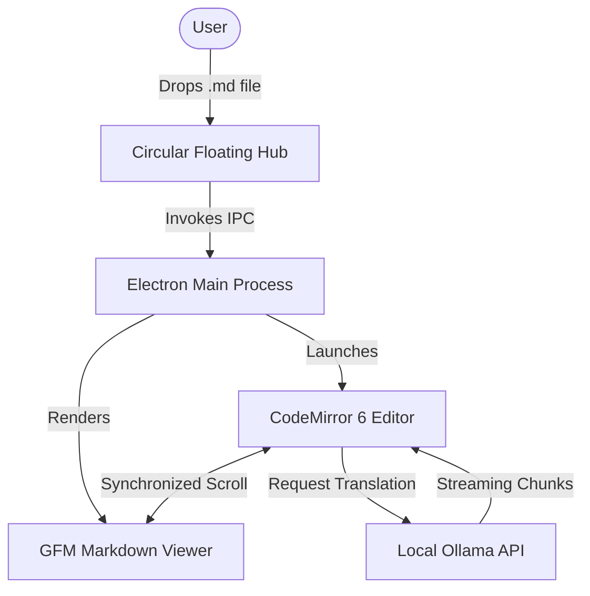

# FlyMD Interactive Showcase 🪶

Welcome to **FlyMD**, the next-generation on-the-fly cross-platform Markdown viewer and editor!

---

## 1. Quick Task Checklist
- [x] Create circular floating hub with upper history and lower open click
- [x] Add HTML5 drag-and-drop support for any Markdown file
- [x] Implement stay-on-top and stay-in-background toggle
- [x] Integrate CodeMirror 6 with live synchronized preview
- [x] Connect local Ollama engine for streaming translation
- [ ] Try dropping this file onto the circular widget!

---

## 2. Mathematical Equations (KaTeX)

Here is an inline equation: $E = mc^2$, and Gauss's Law: $\nabla \cdot \mathbf{E} = \frac{\rho}{\varepsilon_0}$.

And a display math block:

$$
\int_{-\infty}^{+\infty} e^{-x^2} \, dx = \sqrt{\pi}
$$

$$
f(x) = \sum_{n=0}^{\infty} \frac{f^{(n)}(a)}{n!} (x - a)^n
$$

---

## 3. Data Tables

| Feature | Support | Performance |
| :--- | :---: | :--- |
| **Instant Drop Zone** | ✅ Yes | Blazing fast |
| **Local Ollama Translation** | ✅ Yes | Direct stream from `127.0.0.1:11434` |
| **GFM Tables & Checkboxes** | ✅ Yes | Native GitHub styling |
| **Mermaid Charts** | ✅ Yes | SVG vector rendering |

---

## 4. Syntax-Highlighted Code Blocks

```python
import ollama

def translate_markdown(content: str, target_lang: str = "French"):
    response = ollama.generate(
        model="qwen2.5:3b",
        prompt=f"Translate the following markdown to {target_lang}:\n\n{content}",
    )
    return response['response']

if __name__ == "__main__":
    print(translate_markdown("# Hello World"))
```

```typescript
interface FlyMDConfig {
  floatAlwaysOnTop: boolean;
  ollamaModel: string;
  theme: 'dark' | 'light' | 'cyber' | 'sepia';
}

const config: FlyMDConfig = {
  floatAlwaysOnTop: true,
  ollamaModel: 'qwen2.5:3b',
  theme: 'dark',
};
```

---

## 5. Mermaid Architecture Diagram



> **Note**: FlyMD allows editing right next to the preview, with full undo/redo and instant keyboard shortcuts (`Ctrl+S`, `Ctrl+O`, `Ctrl+T`).
